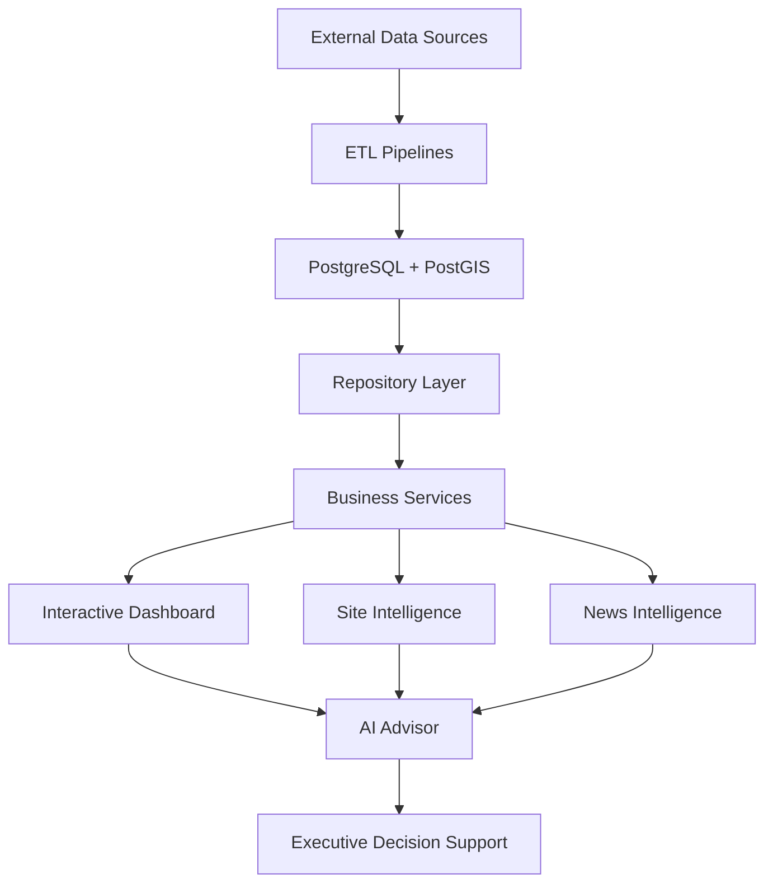

# 🏢 NRW Data Center Business Intelligence Platform

### AI-Powered Geospatial Business Intelligence for Data Center Site Selection and Infrastructure Analysis

The NRW Data Center Business Intelligence Platform is an AI-powered decision support system that combines geospatial analysis, infrastructure intelligence, renewable energy data, market intelligence, and conversational AI into a single interactive dashboard.

Built with **Python**, **PostgreSQL/PostGIS**, **GeoPandas**, **PyDeck**, **Streamlit**, and **OpenAI**, the platform enables users to evaluate data center locations through interactive GIS visualization, site scoring, and AI-assisted insights.

---

## Table of Contents

- [Overview](#overview)
- [Dashboard Preview](#dashboard-preview)
- [Key Features](#key-features)
- [System Architecture](#system-architecture)
- [How It Works](#how-it-works)
- [Dashboard Modules](#dashboard-modules)
- [AI Advisor](#ai-advisor)
- [Technology Stack](#technology-stack)
- [Project Structure](#project-structure)
- [Installation](#installation)
- [Running the Dashboard](#running-the-dashboard)
- [Project Status](#current-project-status)
- [Roadmap](#roadmap)
- [Vision](#vision)

![Python]
![PostgreSQL]
![PostGIS]
![Streamlit]
![OpenAI]
![Status]

## Overview

Selecting an optimal location for a modern data center requires much more than available land.

Power infrastructure, renewable energy, electrical grid capacity, market activity, and surrounding infrastructure all influence the long-term viability of a site.

The NRW Data Center Business Intelligence Platform integrates multiple public infrastructure datasets into a unified PostgreSQL/PostGIS database and provides an interactive AI-powered dashboard for analyzing, comparing, and evaluating potential data center locations.

The platform combines:

- Geospatial Intelligence
- Infrastructure Analysis
- Site Scoring
- Market Intelligence
- AI-assisted Decision Support

# Key Features

## GIS Intelligence

✔ Interactive GIS Infrastructure Map

✔ Data Center Visualization

✔ High Voltage Substations

✔ Transformers

✔ Transmission Lines

✔ Renewable Energy Assets

---

## Business Intelligence

✔ KPI Dashboard

✔ Site Intelligence

✔ Site Score

✔ Market Intelligence

✔ News Intelligence

✔ Spatial Infrastructure Analysis

---

## Artificial Intelligence

✔ AI Advisor

✔ Natural Language Queries

✔ Executive Infrastructure Summaries

✔ Context-aware Responses

✔ Retrieval-Augmented Generation (RAG)

---

## Spatial Intelligence

✔ Power Readiness Analysis

✔ Renewable Energy Analysis

✔ Infrastructure Distance Calculations

✔ Land Value Integration

✔ Site Ranking

# System Architecture


```

┌──────────────────────┐
│ External Data Sources│
└──────────┬───────────┘
           │
           ▼
┌──────────────────────┐
│    ETL Pipelines     │
└──────────┬───────────┘
           ▼
┌──────────────────────┐
│ PostgreSQL + PostGIS │
└──────────┬───────────┘
           ▼
┌──────────────────────┐
│ Repository Layer     │
└──────────┬───────────┘
           ▼
┌──────────────────────┐
│ Business Services    │
└──────────┬───────────┘
           ▼
      ┌────┴────┐
      ▼         ▼
┌──────────┐ ┌──────────┐
│ GIS Map  │ │ News BI  │
└────┬─────┘ └────┬─────┘
     │            │
     └────┬───────┘
          ▼
┌──────────────────────┐
│ Site Intelligence    │
└──────────┬───────────┘
           ▼
┌──────────────────────┐
│ AI Advisor           │
└──────────┬───────────┘
           ▼
┌──────────────────────┐
│ OpenAI GPT           │
└──────────┬───────────┘
           ▼
┌──────────────────────┐
│ Executive Insights   │
└──────────────────────┘
```
```                  

# Dashboard Modules

## Interactive GIS Map

Visualizes:

- Data Centers
- High Voltage Substations
- Transformers
- Renewable Energy Assets
- High Voltage Transmission Lines

---

## KPI Dashboard

Provides executive metrics for infrastructure assets, facilities, and renewable energy resources.

---

## Site Intelligence

Displays infrastructure proximity, renewable energy availability, land valuation, and technical site characteristics for the selected facility.

---

## Site Score

Calculates a unified infrastructure readiness score using spatial analysis and business intelligence metrics.

---

## News Intelligence

Aggregates recent industry news and links relevant articles to companies and facilities.

---

## AI Advisor

Provides conversational access to infrastructure intelligence using natural language.


# AI Advisor

The AI Advisor enables users to explore infrastructure intelligence using natural language.

Current capabilities

- Site Summaries
- Infrastructure Analysis
- Grid Readiness Evaluation
- Renewable Energy Analysis
- Executive Recommendations
- News Summaries

Upcoming

- Intent Detection
- Tool Routing
- Context Awareness
- LangGraph Agents
- Agentic RAG


# Technology Stack

## Backend

- Python
- SQLAlchemy
- PostgreSQL
- PostGIS

## GIS

- GeoPandas
- Shapely
- PyDeck

## Dashboard

- Streamlit

## AI

- OpenAI
- Retrieval-Augmented Generation (RAG)

## Data Processing

- Pandas
- JSON
- GeoJSON

nrw-dc-bi/
│
├── app/
│   ├── services/
│   ├── repositories/
│   ├── database/
│   ├── spatial/
│   ├── intelligence/
│   └── ai/
│
├── ui/
│
├── data/
│
├── scripts/
│
├── tests/
│
└── README.md


# Installation

## Prerequisites

- Python 3.12+
- PostgreSQL 17 + PostGIS
- uv (Python package manager)

Install uv if you don't already have it:

```bash
pip install uv
```

or

```bash
powershell -ExecutionPolicy ByPass -c "irm https://astral.sh/uv/install.ps1 | iex"
```

---

## Clone the Repository

```bash
git clone <repository-url>

cd nrw-dc-bi
```

---

## Create a Virtual Environment

```bash
uv venv
```

Activate it:

### Windows

```bash
.venv\Scripts\activate
```

### Linux / macOS

```bash
source .venv/bin/activate
```

---

## Install Dependencies

```bash
uv sync
```

If you're not using a `uv.lock` yet, then instead use:

```bash
uv pip install -r requirements.txt
```

---

## Configure Environment

```bash
cp .env.example .env
```

Update the database connection and OpenAI API key.

---

## Run Database Migrations

```bash
alembic upgrade head
```

---

## Start the Dashboard

```bash
streamlit run ui/app.py
```

The application will be available at:

```
http://localhost:8501
```

## Requirements

- Python 3.12+
- PostgreSQL 17
- PostGIS
- Git
- uv

## Sentinel-1 soil-wetness candidate indicator

The separate local workflow in `app/satellite/soil_moisture.py` reads aligned,
two-band GeoTIFFs containing calibrated Sentinel-1 VV and VH sigma0. It accepts
linear power or dB input, converts to linear power before building per-pixel
temporal medians, then reports each polarization's current-versus-baseline
anomaly in dB. A pixel is a **wetness candidate** only when both polarization
anomalies meet the configured threshold. This is an auditable backscatter
anomaly heuristic, not a soil-moisture retrieval or causal claim.

The intended imagery source is the [Copernicus Sentinel-1 collection](https://dataspace.copernicus.eu/data-collections/copernicus-sentinel-missions/sentinel-1).
Sentinel data are made available on a free, full, and open basis under the
[Copernicus Sentinel Data Legal Notice](https://sentinels.copernicus.eu/documents/247904/690755/Sentinel_Data_Legal_Notice);
retain the product attribution and review the notice for the selected product.
Supply calibrated, terrain-corrected sigma0 rasters from the same relative
orbit, in EPSG:25832, with consistent dimensions and pixel alignment. Use
product IDs, acquisition timestamps, units, and resolution from the actual
products; no live data downloader or credentials are included. GeoTIFF nodata
and masks are respected. Input raster geometry is validated in EPSG:25832 and
output GeoJSON cell polygons are reprojected to longitude/latitude for standard
GeoJSON consumers. Output records use deterministic `s1wet:tile:date:row:column`
identifiers and are a proposed `iris_staging` file interface; this workflow does
not write to PostgreSQL.

The included result uses synthetic data instead of live imagery because time
and resource constraints did not allow acquiring and preparing a real
Sentinel-1 scene for this exercise. Fixture dates and resolution are
illustrative, not real acquisition metadata.

### Reproducible synthetic example

Install the task-specific pinned dependencies, generate the synthetic rasters,
and run the analyzer:

```bash
python -m pip install -r requirements-sentinel1.txt
python scripts/create_sentinel1_demo.py
python -m app.satellite.soil_moisture \
  --config examples/sentinel1_soil_moisture.config.example.json \
  --output examples/sentinel1_demo_result.geojson
python -m unittest discover -s tests -v
```

The demo writes a GeoJSON FeatureCollection and a companion quality report.
The checked-in example configuration references the generated rasters in
`data/sentinel1_demo/`.
Its small synthetic inputs are generated deterministically and are explicitly
not Sentinel-1 imagery. To run with real imagery, update the example
configuration with real product metadata and file paths.

Docker equivalent:

```bash
docker compose --profile satellite run --build --rm sentinel1-soil-moisture
```

### Schema, assumptions, and limitations

Each valid pixel feature includes the current scene and product IDs, acquisition time,
relative orbit, source row/column, VV and VH anomalies, baseline observation
counts, threshold, and the candidate flag. The report records hashes of source
rasters and configuration, baseline IDs/date range, valid/rejected coverage,
and invalid sample counts. The baseline uses all earlier configured
acquisitions, not the current image, and requires at least three valid baseline
observations per polarization by default.

#### Example quality report

The reproducible synthetic run uses three baseline acquisitions (2025-02-01,
2025-02-13, and 2025-02-25 UTC) and current acquisition
`SYNTHETIC-S1-20250309` (2025-03-09 UTC), all on relative orbit 73. The
illustrative grid is 20 m; this is fixture metadata, not a measured Sentinel-1
resolution. On the 2-by-2 fixture grid, 3 of 4 pixels are valid (75% coverage);
one pixel is rejected because the current VH value is nodata. Of the valid
pixels, one is flagged as a wetness candidate, with VV and VH anomalies of
approximately +2 dB each against the three-scene baseline. A VV-only increase
is not flagged. The configured threshold is 1 dB in both polarizations.

These are synthetic pipeline-validation results, not geographic coverage or
evidence of soil moisture. The baseline is a same-relative-orbit temporal
median in linear sigma0 power, with at least three valid observations per
polarization. Nodata is honored; no spatial speckle filter or terrain, water,
layover, shadow, incidence-angle, or land-cover masks are applied. Backscatter
changes can reflect vegetation, surface roughness, water, topography,
seasonality, crop state, or acquisition geometry; the candidate flag is not a
causal claim or direct soil-moisture measurement. The full machine-readable
counts, rejected-pixel reasons, source identifiers, and hashes are in
[`examples/sentinel1_demo_result_quality_report.json`](examples/sentinel1_demo_result_quality_report.json);
the representative output is
[`examples/sentinel1_demo_result.geojson`](examples/sentinel1_demo_result.geojson).
All 8 automated tests pass, and the same synthetic workflow has been built and
run through the Docker Compose satellite service.

Temporal medians reduce sensitivity to isolated speckle but do not perform
spatial speckle filtering. Results can be confounded by vegetation, roughness,
incidence angle, topography, crop state, orbit/season differences, and
processing differences. The workflow does not calibrate raw DN, apply
terrain/layover/shadow/water masks, retrieve volumetric soil moisture, validate
against ground truth, download products, or load into the database. Real
acquisition date, licensing/attribution, masks, resolution, and uncertainty
must be recorded from the selected products. See [IMPLEMENTATION_NOTES.md](IMPLEMENTATION_NOTES.md)
for the implementation record and demo quality evidence. Per-pixel GeoJSON is
intended as a small-area validation/staging example; large scenes need
windowed raster processing and a raster-native or batched output interface.

# Running the Dashboard

```bash
streamlit run ui/app.py
```
# Current Project Status

## Completed

- Data Collection
- ETL Pipelines
- GIS Dashboard
- Interactive Map
- Site Intelligence
- Site Score
- News Intelligence
- AI Advisor
- Infrastructure Layers

## In Progress

- Context-aware AI
- Intent Detection
- Tool Routing
- LangGraph Integration

## Planned

- Multi-Agent AI
- Predictive Site Recommendations
- Investment Forecasting
- Voice Interface


# Roadmap

## Completed

- ETL Platform
- GIS Visualization
- Business Intelligence Dashboard
- AI Advisor
- News Intelligence

## Next

- Intent Detection
- Context-aware Responses
- Agentic RAG
- LangGraph Workflows

## Future

- Predictive Site Ranking
- Multi-Agent Decision Support
- Voice-enabled AI Advisor


# Vision

The long-term vision is to build an AI-powered decision support platform for data center planning and infrastructure investment.

By combining geospatial intelligence, power infrastructure, renewable energy, land valuation, market intelligence, and conversational AI, the platform enables users to evaluate and compare potential data center locations through natural language interaction.

The project is designed to evolve into a comprehensive executive decision-support system that assists planners, investors, and infrastructure specialists in identifying optimal data center locations.